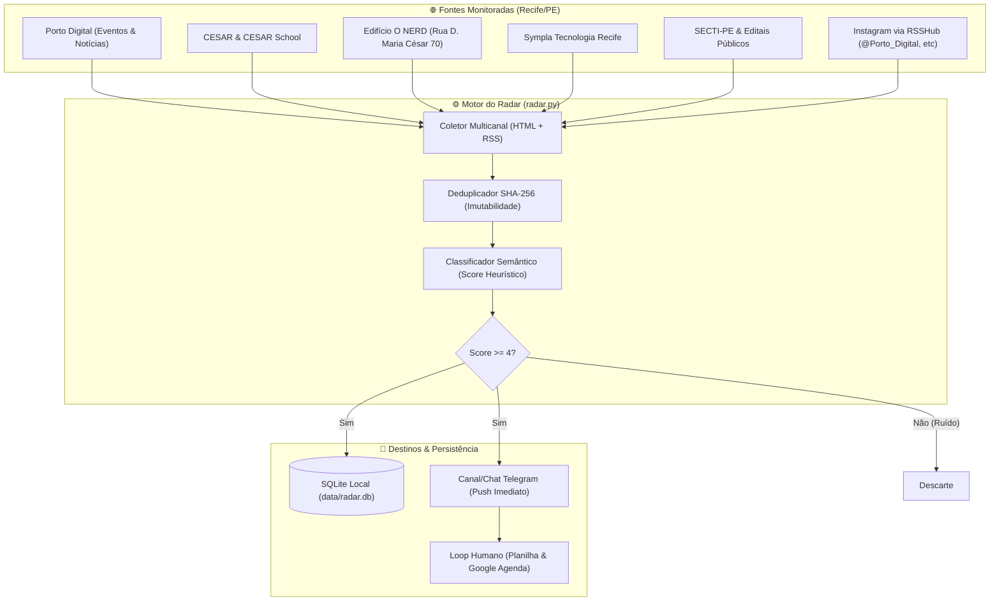

# 🚀 RADAR TECH RECIFE

> **Sistema Autônomo de Inteligência Territorial, Ingestão Multicanal e Monitoramento de Oportunidades Tecnológicas em Recife e Pernambuco.**

O **RADAR TECH RECIFE** monitora de forma contínua e automatizada os principais polos do ecossistema de tecnologia e inovação de Recife (**Porto Digital, CESAR, CESAR School, Edifício O NERD, Sympla e SECTI-PE**), além de perfis estratégicos de redes sociais via pontes RSSHub. Ele extrai, pontua semanticamente via heurística e notifica você instantaneamente no **Telegram**, salvando o histórico imutável em um banco local **SQLite**.

---

## 🧭 Arquitetura do Sistema



---

## 📁 Estrutura de Arquivos

```text
RADAR TECH RECIFE/
├── .env                     # Suas credenciais (Token Telegram, Chat ID)
├── .env.example             # Modelo de referência das variáveis
├── requirements.txt         # Dependências Python (feedparser, requests, etc.)
├── config.py                # Configurações de fontes, feeds e pesos de palavras
├── radar.py                 # Script central de varredura e agendamento
├── query_db.py              # CLI para consultar, filtrar e exportar o banco
├── README.md                # Este manual operacional completo
├── RADAR_TECH_RECIFE_DOSSIE_ASSIMILACAO.md # Dossiê I.D.E.A.L. de Assimilação
├── data/
│   └── radar.db             # Banco de dados SQLite persistente
└── scripts/
    ├── setup_env.ps1        # Cria venv e instala dependências (UTF-8 BOM/CRLF)
    ├── run_radar.ps1        # Dispara o radar em modo contínuo
    ├── test_telegram.ps1    # Testa conexão e envia ping para o bot
    └── inspect_db.ps1       # Mostra estatísticas e histórico de capturas
```

---

## ⚡ Instalação Rápida (Passo a Passo)

### 1. Provisionar o Ambiente
No PowerShell ou terminal da sua IDE dentro da pasta do projeto:

```powershell
.\scripts\setup_env.ps1
```
*Esse script cria o ambiente virtual `.venv`, atualiza o `pip`, instala todas as bibliotecas necessárias e garante as pastas do sistema.*

---

### 2. Configurar o Bot do Telegram

1. Abra o **Telegram** e busque por `@BotFather`.
2. Envie o comando `/newbot` e siga as instruções para criar seu bot (ex: `RadarTechRecife_Bot`).
3. O BotFather fornecerá um **Token de Acesso HTTP API** (ex: `7123456789:AAFlkjhsdf...`).
4. Para receber as notificações:
   - **Opção A (Conversa Direta):** Inicie uma conversa com seu bot clicando em `/start`.
   - **Opção B (Canal Privado - Recomendado):** Crie um canal privado (ex: `Radar Tech Recife`), adicione seu bot como **Administrador** com permissão de publicar mensagens.
5. Para descobrir seu `CHAT_ID`:
   - Abra no navegador: `https://api.telegram.org/bot<SEU_TOKEN>/getUpdates`
   - Procure por `"chat":{"id": -100xxxxxxxxxx}` (se canal) ou `"id": xxxxxxxx` (se conversa direta).
6. Abra o arquivo `.env` e preencha:
   ```env
   TELEGRAM_BOT_TOKEN=seu_token_aqui
   TELEGRAM_CHAT_ID=seu_chat_id_aqui
   ```

---

### 3. Testar a Conexão

Execute o teste rápido para confirmar que o bot está enviando mensagens:

```powershell
.\scripts\test_telegram.ps1
```
*Se receber a notificação no Telegram com sucesso, seu ambiente está 100% calibrado.*

---

## 🚀 Como Executar o Radar

### Modo Contínuo (Agendador Automático a cada 30 min)
```powershell
.\scripts\run_radar.ps1
```
*Ou via Python:*
```powershell
.\.venv\Scripts\python.exe radar.py
```

### Modo Varredura Única (`--once`)
Útil para rodar manualmente ou integrar ao Agendador de Tarefas do Windows:
```powershell
.\.venv\Scripts\python.exe radar.py --once
```

---

## 📊 Como Consultar o Banco de Oportunidades

O script `query_db.py` oferece controle total sobre os dados capturados:

```powershell
# Ver estatísticas gerais (total de oportunidades, por fonte e por prioridade)
.\.venv\Scripts\python.exe query_db.py --stats

# Listar as 20 oportunidades com maior pontuação
.\.venv\Scripts\python.exe query_db.py -n 20

# Filtrar apenas oportunidades de ALTA prioridade
.\.venv\Scripts\python.exe query_db.py -p ALTA

# Buscar por palavra-chave (ex: hackathon, bolsa, edital)
.\.venv\Scripts\python.exe query_db.py -s "hackathon"

# Exportar resultados para planilha CSV (abrir no Excel)
.\.venv\Scripts\python.exe query_db.py --export-csv oportunidades.csv

# Exportar para JSON
.\.venv\Scripts\python.exe query_db.py --export-json oportunidades.json
```

---

## 🎯 A "Regra dos 30 Segundos" para Não Perder Janelas

1. O alerta chega no Telegram categorizado como **🔥 ALTA** ou **⚡ MÉDIA**.
2. Clique no link do alerta e abra a fonte primária.
3. Confira: **Data do Evento, Prazo Limite de Inscrição, Requisitos e Custo**.
4. Anote na sua planilha de controle pessoal.
5. Crie um alarme no **Google Agenda** para 24h antes do encerramento das inscrições.

---

## 🛡️ Execução 24/7 em Segundo Plano no Windows

Se desejar que o Radar execute automaticamente em segundo plano sem manter a janela do terminal aberta:

### Opção 1: Agendador de Tarefas do Windows (Task Scheduler)
1. Pressione `Win + R`, digite `taskschd.msc` e tecle Enter.
2. Clique em **Criar Tarefa Básica...**.
3. Nome: `Radar Tech Recife`.
4. Disparador: **Ao fazer logon** ou **Diariamente** repetindo a cada 1 hora.
5. Ação: **Iniciar um programa**.
   - Programa/script: `C:\Users\lucas\OneDrive\Área de Trabalho\RADAR TECH RECIFE\.venv\Scripts\python.exe`
   - Argumentos: `radar.py --once`
   - Iniciar em: `C:\Users\lucas\OneDrive\Área de Trabalho\RADAR TECH RECIFE`

---

## 📜 Licença e Soberania
Desenvolvido sob o **MODO LUCAS 10.000**. Respeita os padrões de codificação UTF-8 BOM e quebras de linha CRLF para compatibilidade soberana com PowerShell 5.1 e 7+.

