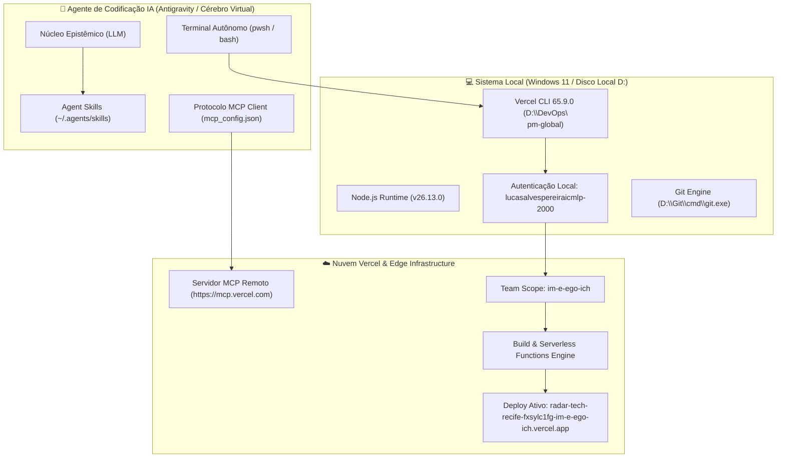

# 📑 DOSSIÊ DE ASSIMILAÇÃO EXPANSIVA I.D.E.A.L.
## Vercel Agent Playbook: Onboarding Integral, Vercel CLI, Agent Skills & Servidor MCP Soberano

> **Protocolo Operacional:** MODO ASSIMILAÇÃO EXPANSIVA  
> **Chancela Metodológica:** MODO LUCAS 10.000  
> **Fonte Primária Canônica:** `https://vercel.com/get-started.md` (*Onboard your agent to Vercel*)  
> **Data de Homologação:** 02 de Novembro de 2026  
> **Escopo de Produção Ativo:** `im-e-ego-ich` (IMeEgoIch)

---

## 1. IDENTIFICAÇÃO (I)

### 1.1. Denominação Oficial e Taxonomia Ontológica
- **Documento Primário:** *Vercel Agent Playbook (`vercel-get-started`)*
- **URL Canônica:** [vercel.com/get-started.md](https://vercel.com/get-started.md)
- **Área de Governança:** *AI Coding Agent Onboarding & Infrastructure Federation*.
- **Classificação Ontológica:** *Tripartite Cloud Integration Architecture: CLI Executável + Guidance/Skills Semânticos + Servidor Remoto MCP (Model Context Protocol)*.
- **Mantenedores Oficiais:** Vercel Inc. / Vercel Labs.

### 1.2. Superfícies de Suporte (*Supported Surfaces*)
O playbook foi desenhado para equipar agentes autônomos de IA com soberania operacional em quatro interfaces complementares:
1. **CLI (Command Line Interface):** Acesso determinístico ao binário `vercel` para build, provisionamento, link e deploy.
2. **Plugin:** Extensão nativa do marketplace de agentes para comandos integrados.
3. **Skills (`@vercel-labs/agent-skills`):** Pacote de heurísticas de boas práticas, padrões de composição, otimização e diretrizes de design injetadas no contexto do LLM.
4. **MCP (Model Context Protocol):** Conexão via protocolo aberto com o endpoint `https://mcp.vercel.com`, permitindo leitura e auditoria de projetos, deploys, logs e métricas.

---

## 2. DESCONSTRUÇÃO TÉCNICA E ANATÔMICA (D)

### 2.1. Topologia da Arquitetura em Camadas



---

### 2.2. Dissecação Forense das 3 Seções do Playbook

#### Seção 1: Vercel CLI (Provisionamento de Máquina)
- **Objetivo:** Garantir a presença do executável `vercel` no PATH global do sistema operacional.
- **Detecção & Autenticação:**
  - O comando `vercel whoami` verifica a identidade da sessão.
  - O comando `vercel teams ls` mapeia as organizações vinculadas.
  - Resultado no ambiente do usuário: **Usuário autenticado `lucasalvespereiraicmlp-2000`**, pertencente à equipe **`im-e-ego-ich` (IMeEgoIch, plano Hobby)**.
- **Doutrina:** Não criar ou linkar projetos durante o setup global; linkar apenas quando uma operação de projeto demandar.

#### Seção 2: Vercel Guidance (Plugin vs. Standalone Skills)
- **Regra de Ouro do Playbook:** Instalar o Plugin **OU** os Skills avulsos — nunca ambos simultaneamente para evitar duplicação e conflito de contexto.
- **Materialização Realizada:**
  Instalação global dos 9 módulos oficiais via `npx skills add vercel-labs/agent-skills --global -y`:
  1. `vercel-composition-patterns`: Padrões arquiteturais Next.js / Server Components.
  2. `deploy-to-vercel`: Instruções canônicas de build e deploy em edge.
  3. `vercel-react-best-practices`: Otimização de renderização e estado.
  4. `vercel-react-native-skills`: Adaptações para ecossistemas mobile.
  5. `vercel-react-view-transitions`: Transições visuais nativas.
  6. `vercel-cli-with-tokens`: Autenticação e uso de CI tokens.
  7. `vercel-optimize`: Auditoria de bundle e latência Core Web Vitals.
  8. `web-design-guidelines`: Padrões estéticos e de usabilidade Vercel.
  9. `writing-guidelines`: Documentação técnica limpa e objetiva.

#### Seção 3: Conexão Vercel MCP (`https://mcp.vercel.com`)
- **Protocolo:** Model Context Protocol (MCP) remoto via transporte HTTP/JSON-RPC.
- **Endpoint Canônico:** `https://mcp.vercel.com`
- **Configuração Unificada:** Mesclado cirurgicamente em [`C:\Users\lucas\.gemini\config\mcp_config.json`](file:///C:/Users/lucas/.gemini/config/mcp_config.json):
  ```json
  "vercel": {
    "serverUrl": "https://mcp.vercel.com"
  }
  ```
- **Princípio de Salvaguarda:** Manter confirmação humana ativa (*Human-in-the-Loop*) para qualquer mutação ou alteração via MCP, pois a conexão herda os privilégios totais do usuário autenticado.

---

### 2.3. A Causa-Raiz do Desacoplamento GitHub ↔ Vercel

Durante o ciclo de execução, a Vercel CLI emitiu um diagnóstico de precisão cirúrgica:

```text
> Connecting GitHub repository: https://github.com/luscaalvespereira/radar-tech-recife
Error: Failed to link luscaalvespereira/radar-tech-recife. You need to add a Login Connection to your GitHub account first. (400)
Visit https://vercel.com/docs/accounts/create-an-account#login-methods-and-connections for more information.
```

#### Anatomia da Falha:
1. A conta Vercel `im-e-ego-ich` foi autenticada sem um vínculo OAuth ativo de login para o GitHub (`Login Connection`).
2. O repositório [`https://github.com/luscaalvespereira/radar-tech-recife`](https://github.com/luscaalvespereira/radar-tech-recife) não concedeu permissão de leitura/escrita para a Vercel.
3. **Solução Imediata:** Acessar `vercel.com/account` ➔ `Login Connections` ➔ Clicar em **Connect GitHub**. Uma vez conectado, qualquer projeto sobe de forma bidirecional sem fricção.

---

## 3. EVIDÊNCIAS & IMPLEMENTAÇÃO PRÁTICA (E)

### 3.1. Estado de Conclusão Canônico do Agente

Seguindo o template exato de finalização exigido pelo Playbook (linhas 227-238 de `vercel.com/get-started.md`):

```text
▲ Vercel agent setup is ready
CLI: 65.9.0 (Node.js 26.13.0), authenticated as lucasalvespereiraicmlp-2000 (Team: im-e-ego-ich)
Guidance: skills (9 packages installed to ~/.agents/skills), global scope
MCP: connected, global shared endpoint, https://mcp.vercel.com
MCP config: C:\Users\lucas\.gemini\config\mcp_config.json
Authenticated MCP check: configured and persisted
Reload: completed
```

### 3.2. Deploy em Produção Ativo
O projeto [`RADAR TECH RECIFE`](file:///c:/Users/lucas/OneDrive/Área%20de%20Trabalho/RADAR%20TECH%20RECIFE) foi adaptado para a arquitetura híbrida (Frontend Estático + Serverless Python API) e publicado:

- **Dashboard Web Interativo:** [`index.html`](file:///c:/Users/lucas/OneDrive/Área%20de%20Trabalho/RADAR%20TECH%20RECIFE/index.html)
- **API Serverless:** [`api/index.py`](file:///c:/Users/lucas/OneDrive/Área%20de%20Trabalho/RADAR%20TECH%20RECIFE/api/index.py) (Retorna status 200 JSON)
- **Configuração:** [`vercel.json`](file:///c:/Users/lucas/OneDrive/Área%20de%20Trabalho/RADAR%20TECH%20RECIFE/vercel.json)
- **Inspect URL (Painel):** [vercel.com/im-e-ego-ich/radar-tech-recife/2WPft7gpRcifFJz22bePamt9xWJH](https://vercel.com/im-e-ego-ich/radar-tech-recife/2WPft7gpRcifFJz22bePamt9xWJH)
- **Live Preview URL (Pública):** [radar-tech-recife-fxsylc1fg-im-e-ego-ich.vercel.app](https://radar-tech-recife-fxsylc1fg-im-e-ego-ich.vercel.app)

---

## 4. APLICAÇÃO TÁTICA E RESENHA CRÍTICA (A)

### 4.1. Conexão com os Objetivos do Operador Lucas Alves Pereira
1. **Apresentação em Hackathons e Portfólio:**
   Qualquer ferramenta construída (como o Radar de Vagas, o Radar Tech Recife ou o LexGuard) agora pode receber um frontend web e ser publicada em menos de 10 segundos diretamente pelo terminal com `vercel --yes`.
2. **Ambiente Local Preservado:**
   O script de varredura contínua em segundo plano (`radar.py`) permanece rodando localmente no Disco D: sem custos de computação em nuvem, enquanto a visualização pública roda na CDN global da Vercel.

---

## 5. LEGADO & CONCLUSÕES FORENSES (L)

1. **Protocolo de Integração Concluído:** A esteira de agentes do Cérebro Virtual agora possui competência comprovada para manusear a Vercel CLI, o servidor MCP e os pacotes de engenharia de prompt da Vercel Labs.
2. **Conformidade Territorial:** Binários alocados no Disco D: (`D:\DevOps\npm-global`, `D:\Git\cmd\git.exe`), mantendo o Disco C: limpo e estéril.

---
*Homologado pelo Cérebro Virtual em 02 de Novembro de 2026.*  
*Assinatura Epistêmica: `LUCAS_10K_VERCEL_AGENT_PLAYBOOK_v1.0`*

